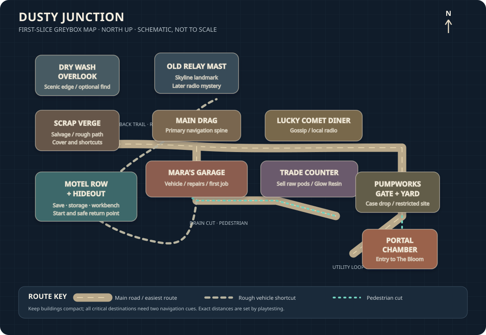

# Dusty Junction — Greybox Blockout Specification

**Status:** Proposed implementation brief; not authorization to create the engine project.
**Purpose:** Remove ambiguity so an AI coding assistant can build a coherent, testable first district without inventing a sprawling open world.

## Visual reference



## Player experience target

The player should be able to leave the hideout, recognize the main road and key landmarks, reach Mara's garage, drive to Pumpworks, and return without a map. The town should feel like a compact, odd roadside community, not a generic city grid. Every major landmark needs a distinct silhouette and a gameplay reason to exist.

## Scale targets

These are initial tuning targets to test, not fixed lore:
- Playable town footprint: approximately 500 m × 500 m.
- Main activity loop: roughly 450–650 m around the hideout, garage, trade counter, and Pumpworks gate.
- Walking time from hideout to Pumpworks: 3–5 minutes using the direct route.
- Driving time from hideout to Pumpworks: 1–2 minutes.
- At least two route choices: a safe, obvious road and a rough shortcut with a visible trade-off.
- No large empty traversable areas. Distant scenery may be blocked or decorative.
- The first route should be readable without a minimap.

## Top-down layout

North is up. This is a navigation diagram, not a surveyed map. Distances and exact orientations are adjusted during greyboxing.

```text
                           NORTH
                 [Dry Wash Overlook]
                         |     \
                  [Old Relay Mast]--[Back Trail]
                         |              |
 [Scrap Verge]------[Motel Row]------[Main Drag]------[Lucky Comet Diner]
      |                 |                 |                    |
 [Salvage Lot]    [Hideout Room]     [Mara's Garage]----[Trade Counter]
      |                 |                 |                    |
 [Drain Cut]--------[Utility Loop]---[Pumpworks Gate]----[Service Yard]
                                           |
                                    [Portal Chamber]
                                           |
                                    [Dimension Return]
```

## Route graph and gates

- **Route A — Main road:** easy to read, widest, safest; connects Motel Row → Main Drag → Garage/Trade Counter → Pumpworks Gate.
- **Route B — Back trail:** shorter or faster by vehicle but uneven, with one obstacle that teaches vehicle handling. It must never permanently trap the player.
- **Route C — Drain cut:** a pedestrian shortcut unlocked or made obvious after the player learns the district. Avoid complex jumping or precision platforming.
- **Portal path:** Pumpworks Gate → fenced utility yard → readable portal chamber. The portal is a focal point visible from the yard, not an invisible trigger.
- **Return path:** the same portal always provides a safe way home in the first slice. No random portal failure or forced stranding.

## Landmark construction briefs

### 1. Motel Row and hideout
- One motel-office facade, one short row of doors, parking strip, damaged vacancy sign, a small playable hideout room.
- Interior needs: bed/save point, storage crate, wall map or mission board, basic workbench, door back outside.
- Must be the clear start and return point. Keep interactions close together.

### 2. Main Drag
- One curved or kinked road, power poles, overhead cables, roadside signs, one abandoned freight feature.
- Use asymmetrical rooflines, setbacks, awnings, and varied building heights. Do not repeat the same box shape.
- Buildings not needed for the slice should be closed facades or blocked interiors.

### 3. Mara's Garage
- Two visible bays, patched doors, mismatched panels, parts cage, service board.
- Mara must be easy to spot from the entrance. The vehicle upgrade interaction should be obvious.
- First vehicle should spawn/recover here if the player loses it.

### 4. Lucky Comet Diner
- Curved canopy or a bold sign silhouette; warm window light and a local radio/gossip hook.
- It can be mostly exterior in the first slice. Do not build a full restaurant interior unless needed by the mission.

### 5. Trade Counter
- Small pawn/salvage counter with a distinct sign and a single clear interaction point.
- Supports selling raw Lumen Pods versus processing them into Glow Resin at a basic workbench.
- Interface must show price and risk consequence before confirming.

### 6. Pumpworks
- Industrial pump housing, pipes, fenced yard, broken warning beacons, one obvious portal chamber.
- The portal should have a readable silhouette and clear sound/light cue from the approach.
- Separate the player from hazards with geometry, not invisible barriers wherever possible.

### 7. Dry Wash Overlook and salvage verge
- Decorative boundary landmarks, a few optional salvage pickups, and visual storytelling.
- Keep the first version sparse. Do not turn them into separate mission zones yet.

## Blockout and collision rules

- Use primitive geometry first. Do not create final textures, detailed props, or complex materials during the greybox phase.
- All critical doors, pickups, NPCs, portal surfaces, and interaction points must be reachable by both keyboard/mouse and controller.
- Provide obvious collision boundaries and visual landmarks; no invisible walls in the middle of expected paths.
- Use consistent world units and document the engine's unit convention.
- Keep all mission-critical interactables on a reliable, testable interaction channel.
- Add a vehicle recovery option so a physics glitch cannot block progress.
- Every important route needs a fallback path if physics or collision prevents traversal.

## Greybox acceptance checklist

- [ ] Start in hideout, exit, and find the garage without a map.
- [ ] Identify the diner, trade counter, and Pumpworks from landmark silhouettes/signage.
- [ ] Reach Pumpworks on foot and by vehicle.
- [ ] Back trail feels distinct and does not trap the vehicle.
- [ ] Enter and return from The Bloom without losing mission state.
- [ ] All interactions work using keyboard/mouse and controller.
- [ ] No mission-critical item spawns inside collision.
- [ ] Player can recover a stuck or lost vehicle.
- [ ] Save/load preserves player location safely, mission state, inventory, and currency.
- [ ] Performance and load times are measured on the actual development machine.

## Explicit exclusions

No full city, traffic simulation, pedestrian crowd simulation, building interiors for every facade, destructible structures, procedural city generation, multiplayer, or extra dimensions in this blockout.
