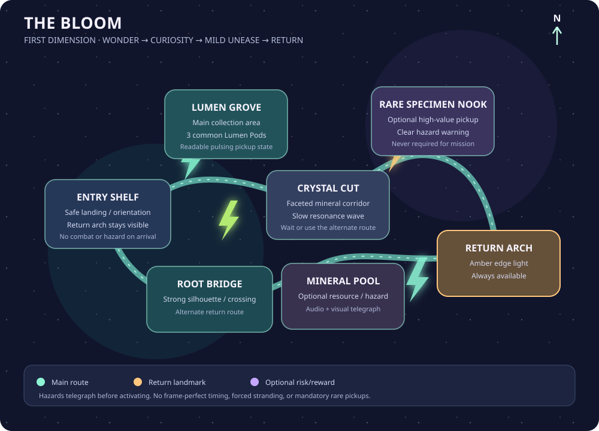

# World Design — Dusty Junction and The Bloom

## Scale and navigation
Dusty Junction is a compact hand-authored hub built around a failed freight stop and a municipal pumping station. Provisional blockout target: 450–650 m across; 3–5 minutes on foot across the main activity loop and 1–2 minutes by vehicle. These are test targets, not promises. Use a readable loop with shortcuts rather than a maze.

## Town blockout (schematic; north at top)


```text
                         N
       [Dry Wash Overlook]----[Old Relay Mast]
                |                    |
        [Scrap Verge]---[Back Trail]-+
             |              |
 [Motel Row / Hideout]---[Main Drag]----[Lucky Comet Diner]
             |               |                 |
       [Motel Courtyard] [Mara's Garage]---[Pawn / Trade Counter]
             |               |
         [Drain Cut]----[Pumpworks Gate]---[Utility Yard]
                                |
                         [Portal Chamber]
                                |
                         [Utility Loop Road]
```

## Districts and landmarks
- **Motel Row / Hideout:** converted service room behind a failing motel office. Bed, battered fridge, storage crate, wall map, upgradeable workbench. Sun-faded turquoise and violet vacancy sign. Hub for saving, storage, processing, leads, and safe preparation.
- **Main Drag:** uneven pavement, utility poles, cable bundles, retro-future storefronts. Distinct rooflines and signage; no repeated box-building row.
- **Mara's Garage:** two bays, lift, mismatched panels, parts cage, hand-painted service board. Vehicle tutorial and upgrade contact.
- **Lucky Comet Diner:** curved canopy, checkerboard accents, humming drink dispenser, local radio and gossip.
- **Pawn / Trade Counter:** buys ordinary goods, raw Lumen Pods, Glow Resin, and salvage; legal low-risk outlet for basic items, with a buyer's sign and environmental storytelling wall. It does not process items in the first slice.
- **Scrap Verge:** compact junkyard with walkable elevated path, cover, salvage and shortcut; not a maze.
- **Pumpworks:** fenced municipal utility property, maintenance sheds, cylindrical portal chamber, warning signs, scorch marks, impossible shadows. The courier may reach the public-facing service drop legally; the inner portal boundary is clearly marked restricted. Crossing it can trigger suspicion, but the first warning must not block the tutorial portal path.
- **Dry Wash Overlook:** quiet edge-of-map vista and optional collectible location.
- **Old Relay Mast:** recognizable skyline marker and source of later radio mystery.

## Route logic
- **Main Drag:** primary readable route.
- **Back Trail:** rough shortcut behind motel and scrap piles; easier on foot than by car.
- **Drain Cut:** concealed pedestrian route to Pumpworks; shortcut, not mandatory stealth.
- **Utility Loop:** vehicle approach and escape route around the pumping station.
- **Dry Wash Road:** connects scenic overlook and gathering locations.

Every important destination has at least two navigation cues: silhouette, color, signage, sound, light, or road geometry. Waypoints assist but are not the only way to navigate.

## Dimension 1: The Bloom
A pocket ecosystem around a mineral fracture. Palette: indigo/petrol shadows, mint and acid-lime bioluminescence, amber mineral cores, restrained coral accents. Do not make everything neon; negative space creates wonder.

### Dimension map



```text
                 [Rare Specimen Nook]
                          |
[Entry Shelf]---[Lumen Grove]---[Crystal Cut]
      |               |                |
[Return Arch]---[Root Bridge]----[Mineral Pool]
```

- **Entry Shelf:** safe landing, clear view of return arch, orientation point.
- **Lumen Grove:** primary Lumen Pod collection area; pods pulse gently.
- **Crystal Cut:** faceted mineral corridor; slow resonance field makes timing relevant without twitch demands.
- **Root Bridge:** elevated crossing above a dark pool; strong silhouette and screenshot composition.
- **Mineral Pool:** optional node with a readable hazard cycle and distinctive audio cue.
- **Rare Specimen Nook:** optional high-value pickup; risk is communicated and it is never required.

## Portal
Town-side portal is a vertical tear held inside a ring of repurposed industrial braces, with a liquid-glass surface and a soft harmonic. Municipal hardware—not a fantasy stone arch—grounds the visual design. Nearby objects distort subtly.

Transition: interact → show destination/risk confirmation if needed → brief audiovisual transition → load destination → spawn at safe marker → restore mission/UI state. Return uses the same path. Failed load returns safely to source world without destroying inventory.

## Environmental storytelling
- Incident notice with redactions.
- Radio host insists impossible lights are “weather.”
- Sampling containers lead to a locked gate.
- Garage invoice for equipment no shop remembers ordering.
- Alien growth repeats shapes found in old electrical diagrams.
- An NPC has moved their chair so they never face the portal.

## Modular construction
Greybox first. Kits: storefront, garage, motel, utility building, fences/gates, roadside props, signs, street furniture, small interiors. Test sightlines, vehicle turning radius, foot shortcuts, and objective clarity before detail.

## Future districts (backlog only)
Relay Fields (antenna farms/radio cult), Glass Mile (mirage road), Salt Works (industrial extraction), Quiet Borough (residents pretending nothing is wrong). None are first-slice commitments.
